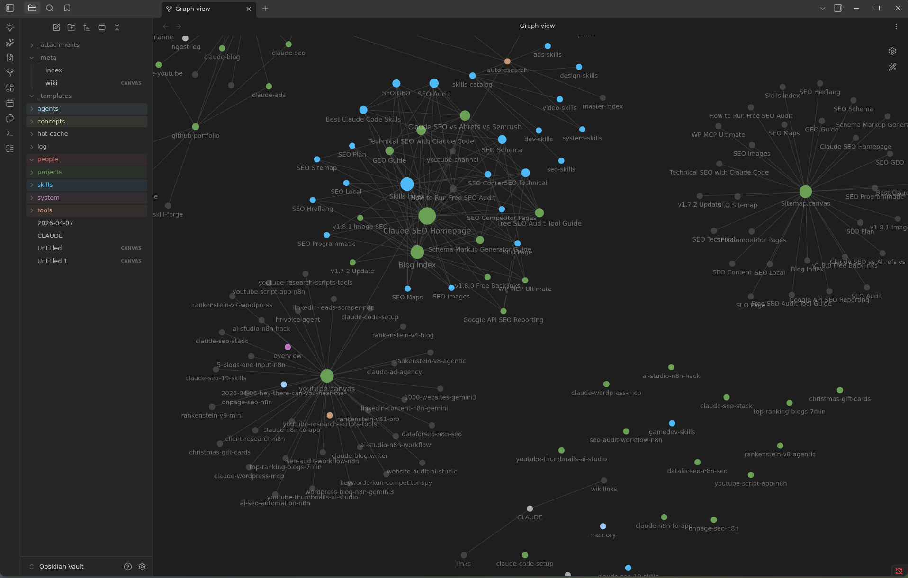

<!--
  claude-obsidian: a free, open-source AI second brain for Obsidian and Claude Code, by Agrici Daniel.
  Drop in sources and Claude reads, links and files them into a connected knowledge graph of plain Markdown you own.
  Personal knowledge management (PKM), AI note-taking and a local-first wiki, based on Andrej Karpathy's LLM Wiki pattern.
  15 skills and 3 agents. Works in Claude Code, Codex, OpenCode, Gemini, ZCode, Cursor and Windsurf. MIT licensed.
-->



<h1 align="center">claude-obsidian</h1>

<p align="center">
  <b>Your AI second brain for <a href="https://obsidian.md">Obsidian</a>, built for <a href="https://claude.com/product/claude-code">Claude Code</a>.</b><br />
  Drop in sources. Get a connected wiki that grows every time you use it.
</p>

<p align="center">
  <a href="#install">Install</a> ·
  <a href="#see-the-vault">See the vault</a> ·
  <a href="#15-skills-one-system">Skills</a> ·
  <a href="#meet-the-crew">Agents</a> ·
  <a href="#nothing-gets-lost">Safety</a> ·
  <a href="#shape-the-vault-to-the-way-you-think">Modes</a> ·
  <a href="#faq">FAQ</a>
</p>

<p align="center">
  <a href="https://github.com/AgriciDaniel/claude-obsidian/actions/workflows/test.yml"></a>
  <a href="https://code.claude.com/docs/en/plugins"></a>
  <a href="https://agentskills.io"></a>
  <a href="LICENSE"></a>
  <a href="CHANGELOG.md"></a>
  <a href="https://github.com/AgriciDaniel/claude-obsidian/stargazers"></a>
  <a href="https://www.skool.com/ai-marketing-hub-pro"></a>
</p>

<p align="center">
  <a href="https://www.star-history.com/agricidaniel/claude-obsidian">
    <picture>
      <source media="(prefers-color-scheme: dark)" srcset="https://api.star-history.com/badge?repo=AgriciDaniel/claude-obsidian&type=trending&theme=dark" />
      
    </picture>
  </a>
</p>

**claude-obsidian turns the things you read into a knowledge base that keeps getting more useful.** Drop a paper, an article, a transcript or your own notes into the vault, and Claude reads them, writes linked notes with sources, and files everything into one connected knowledge graph you can explore in Obsidian.

- **Capture.** Put sources in `inbox/`. The originals are kept, untouched, so every summary can point back to where it came from.
- **Connect.** Claude writes linked pages, indexes and maps of content, so new ideas join the graph instead of piling up.
- **Ask.** Get answers from what your vault already knows, with citations, without changing a single file.
- **Save.** Keep the answers worth keeping as notes, one at a time, when you ask.
- **Check.** A health check finds dead links, orphan pages and gaps before they spread.

Everything stays as plain Markdown files on your computer. No cloud database, no lock-in, no telemetry. Apart from the AI tool you chat with, nothing leaves your machine unless you say so.

## See the vault

The result is a normal Obsidian vault that stays useful with or without an AI: browse it in Graph view, or lay it out as a map in Obsidian Canvas.

<p align="center">
  
  
</p>

<p align="center"><sub>Linked notes in Graph view · A knowledge map in Obsidian Canvas</sub></p>

## Install


You need [Claude Code](https://claude.com/product/claude-code), Python 3.11 or newer and, for the visual side, [Obsidian](https://obsidian.md). Install the plugin with two commands:

```bash
claude plugin marketplace add AgriciDaniel/claude-obsidian
claude plugin install claude-obsidian@agricidaniel-claude-obsidian
```

Then open the folder you want as your vault and start Claude Code there:

```bash
claude                                   # start Claude Code in your vault folder

/claude-obsidian:wiki                    # set up the vault (shows you a preview first)
/claude-obsidian:wiki-ingest             # turn what is in inbox/ into linked notes
/claude-obsidian:wiki-query              # ask a question, answered from your notes
/claude-obsidian:save                    # keep a good answer as a note
/claude-obsidian:wiki-lint               # health check: dead links, orphans, gaps
```

Open the same folder in Obsidian with **Open folder as vault** to browse your notes as they grow.

Already have an Obsidian vault? `/claude-obsidian:wiki` can adopt it without moving your notes. The [installation guide](docs/install-guide.md#adopt-an-existing-vault) walks through it.

<details>
<summary><b>Other AI tools: Codex, OpenCode, Gemini, ZCode, Cursor and Windsurf</b></summary>
<br />

claude-obsidian is a set of [Agent Skills](https://agentskills.io), so it also runs in other hosts. From a copy of this repo, preview the setup, then apply it:

```bash
git clone https://github.com/AgriciDaniel/claude-obsidian.git
cd claude-obsidian
bash scripts/setup-multi-agent.sh --host codex            # preview, writes nothing
bash scripts/setup-multi-agent.sh --host codex --apply    # link the skills
```

Use `--host opencode`, `--host gemini` or `--host zcode` the same way. Cursor and Windsurf need a workspace: `--host cursor --host windsurf --workspace <folder> --apply`. Every host is covered in the [installation guide](docs/install-guide.md).

</details>

<details>
<summary><b>Windows</b></summary>
<br />

On Windows, use WSL for anything that writes to the vault. Native Windows can inspect and preview, and stops with a clear error instead of writing. The [Windows and WSL guide](docs/windows-wsl.md) has the details.

</details>

<details>
<summary><b>Upgrading from 2.x or 3.0.0</b></summary>
<br />

```bash
claude plugin marketplace update agricidaniel-claude-obsidian
claude plugin update claude-obsidian@agricidaniel-claude-obsidian
```

Version 3.0.0 alone used the plugin name `agricidaniel-obsidian`. If you installed that one, run the marketplace update, then `claude plugin install claude-obsidian@agricidaniel-claude-obsidian`, and restart Claude Code. See the [namespace migration](docs/namespace-migration.md).

</details>

## 15 skills, one system



Talk to it in plain words, or call any skill by name with `/claude-obsidian:<skill>`. Open a group to see what is inside.

<details open>
<summary><b>Build and use the wiki</b> (5)</summary>
<br />

| Skill | What it does |
|---|---|
| `wiki` | Sets up a new vault or adopts yours, checks it is ready and routes your request |
| `wiki-ingest` | Turns captured sources into linked pages with their sources recorded |
| `wiki-query` | Answers from what is already in the vault, read-only |
| `save` | Keeps one answer or insight as a note, only when you ask |
| `wiki-lint` | Finds dead links, orphan pages, missing metadata and empty sections |

</details>

<details>
<summary><b>Extend the workflow</b> (7)</summary>
<br />

| Skill | What it does |
|---|---|
| `autoresearch` | Bounded web research, only with your consent, merged after review |
| `canvas` | Creates and updates Obsidian Canvas boards |
| `defuddle` | Plans a clean Markdown capture of a web page; the cleaner itself is an optional external tool |
| `wiki-fold` | Rolls up the operation log into short, traceable summaries |
| `wiki-mode` | Sets how new notes are filed: Generic, LYT, PARA or Zettelkasten |
| `wiki-retrieve` | Local BM25 search with optional reranking |
| `wiki-cli` | Reads and searches through the official Obsidian command line |

</details>

<details>
<summary><b>Reference</b> (3)</summary>
<br />

| Skill | What it does |
|---|---|
| `obsidian-markdown` | Correct Obsidian Markdown: links, embeds, callouts and properties |
| `obsidian-bases` | Native .base tables, cards, filters and formulas |
| `think` | A structured review loop for hard decisions |

</details>

## Meet the crew



Behind the skills, three agents do the heavy reading and checking. All three are **read-only**: they hand back drafts and reports, and only one place, the transaction core, ever writes to your vault.

| Agent | What it does |
|---|---|
| `wiki-ingest` | Reads one captured source and hands back page drafts, with the hash it expects each target to have |
| `wiki-lint` | Runs the vault linter, double checks surprising findings and returns a health report |
| `verifier` | Runs safe tests on a proposed change or release and ranks what it finds |

**Built for:**

- **Researchers and students** who read a lot and want every note to point back to its source.
- **Writers and creators** who want ideas from videos, articles and books to connect instead of getting lost in folders.
- **Builders and teams** who keep project knowledge in Markdown and want an AI that can search it, cite it and keep it tidy.

## Nothing gets lost



Your notes matter, so every change to the vault works like a careful save:

1. **Read first.** Claude reads every note it will touch and records a fingerprint (a SHA-256 hash) of each one.
2. **One plan, one apply.** Helpers can work in parallel, but they only hand back drafts. Claude merges them into one plan, checks it, and applies it as a single transaction.
3. **Undo if anything breaks.** A journal keeps backups during the write. If the power cuts out halfway, `transaction recover` rolls the unfinished change back from the journal.
4. **Your edits win.** If you change a note in Obsidian while Claude is planning, the fingerprint no longer matches and the write stops with a conflict instead of overwriting you.

Web research, Git checkpoints and anything that sends data off your machine are separate steps that ask you first.

<details>
<summary><b>For the curious: how the vault is chosen and protected</b></summary>
<br />

The plugin never treats its own folder or cache as your vault. A vault is picked explicitly: through `CLAUDE_OBSIDIAN_VAULT`, the nearest `.claude-obsidian.json`, or one clear initialized parent folder. If it is not sure, it exits without writing.

The lock coordinates local writers that cooperate with it. Other devices and external editors do not share it, so keep backups, especially when you sync Canvas or Base files. Read the [transaction contract](skills/wiki/references/operation-transactions.md), the [provenance contract](skills/wiki/references/provenance.md) and the [Compound Vault guide](docs/compound-vault-guide.md) for the full detail.

</details>

## Shape the vault to the way you think



`wiki-mode` sets how new notes are filed, the way you already like to work. Switching modes changes where new notes go and never moves your old ones.

| Mode | How notes are filed |
|---|---|
| **Generic** (default) | Sources, concepts, entities and sessions |
| **LYT** | Maps of Content and linked atomic notes |
| **PARA** | Projects, Areas, Resources and Archives |
| **Zettelkasten** | Stable IDs, atomic notes and dense links |

More in the [methodology modes guide](docs/methodology-modes-guide.md).

## How it works

1. **Capture.** Sources go into `inbox/`. claude-obsidian keeps an untouched copy of each one, named by its content, before anything is summarized.
2. **Ground.** Each important claim in a note is linked to the source that supports it. Weak or conflicting evidence stays visible instead of being smoothed over.
3. **Compound.** Ask, research, search and lint use what the vault already knows, so every session starts from your notes instead of from zero.

The idea follows [Andrej Karpathy's LLM Wiki pattern](https://gist.github.com/karpathy/442a6bf555914893e9891c11519de94f): let the AI maintain a wiki you can read, instead of a black box you cannot.

<details>
<summary><b>What it can and cannot read today</b></summary>
<br />

| Input or feature | Support today |
|---|---|
| Local files | Captured and kept as content-addressed copies |
| Images | Metadata, hash, size and dimensions when available |
| PDF and EPUB | Metadata, hash and size; no built-in text extraction yet |
| Web pages and YouTube | Prepared as a plan you approve; fetching needs a separate runner that enforces it |
| OCR | Needs an external tool you configure |
| Search (BM25) | Local and deterministic |
| Reranking or remote models | Optional, and only with your explicit consent |
| Obsidian CLI | Optional for reading and search |

</details>

<details>
<summary><b>Command line reference</b></summary>
<br />

From a clone of this repo, the same core is available as a portable command line: `python3 scripts/claude-obsidian.py`. Commands that change files show a plan first and only apply with the plan's hash.

| Command | What it does |
|---|---|
| `doctor --vault PATH` | Shows which vault is selected and whether it is ready |
| `init PATH` | Plans, then creates, a new vault |
| `adopt PATH` | Plans, then adopts, an existing Obsidian vault |
| `lint --vault PATH` | Runs the health check |
| `capture plan` / `capture apply` | Checks, then keeps, copies of local sources |
| `transaction recover --vault PATH` | Restores the vault after an interrupted write |
| `bench --queries FILE --vault PATH` | Measures search quality on your own questions |

Run `python3 scripts/claude-obsidian.py --help`, or add `--help` to any command, to see every option.

</details>

## FAQ

<details>
<summary><b>What is claude-obsidian?</b></summary>
<br />

A free, open-source AI second brain for Obsidian: a personal knowledge management (PKM) and AI note-taking system that builds a knowledge graph of plain Markdown. It is a Claude Code plugin (and a set of Agent Skills for other AI tools) that turns your sources into linked, cited notes, answers questions from them, and keeps the vault healthy over time.

</details>

<details>
<summary><b>Is it free?</b></summary>
<br />

Yes. It is MIT licensed with no subscription and no tracking. You use it with your own Claude Code plan, or with another AI tool you already have.

</details>

<details>
<summary><b>Do I need Obsidian?</b></summary>
<br />

No, but it is the nicest way to see the result. The vault is plain Markdown, so any editor works. Obsidian adds Graph view, Canvas maps and Bases tables on top.

</details>

<details>
<summary><b>Is this an Obsidian community plugin?</b></summary>
<br />

No. You don't install it from Obsidian's community plugin list. It is a Claude Code plugin (and a set of Agent Skills for other AI tools) that works on your vault folder. Obsidian opens the result as a normal vault, and no Obsidian plugin is required.

</details>

<details>
<summary><b>Does my data leave my computer?</b></summary>
<br />

Your vault stays on your computer as ordinary files. When you work with it in Claude Code, the notes Claude reads are sent to Claude, Anthropic's model, the same as anything else you open in Claude Code. Web research and remote models are off until you allow them for a task.

</details>

<details>
<summary><b>Will it mess up my existing notes?</b></summary>
<br />

It is built not to. Adopting a vault does not move your notes, every change is shown as a plan before it is applied, and an interrupted write can be rolled back. If you edit a note while Claude is working on it, the write stops instead of overwriting you. Keep normal backups anyway.

</details>

<details>
<summary><b>How is it different from a chat that saves notes?</b></summary>
<br />

Most AI note tools save text and stop. claude-obsidian keeps the original sources, links every claim back to them, connects new notes to old ones, and checks the vault for broken links and gaps. The knowledge compounds instead of piling up.

</details>

<details>
<summary><b>Does it work with Codex, Gemini or Cursor?</b></summary>
<br />

Yes. The skills follow the open Agent Skills format. Claude Code gets the full plugin; Codex, OpenCode, Gemini, ZCode, Cursor and Windsurf link the same skills with one setup script. See [Install](#install).

</details>

<details>
<summary><b>Good to know: requirements, limits and uninstall</b></summary>
<br />

**Requirements.** Python 3.11 or newer, a current Claude Code release for the plugin (or another Agent Skills host), Obsidian for the visual side, and Bash for the setup scripts. Git is only needed for development or checkpoints.

**Limits.** It is not an automatic transcript recorder, a cloud sync service or a fact checker, and it does not replace backups. PDFs and web pages need extra tools for full text.

**Uninstall.** Removing the plugin never removes your vault. Your notes, sources and Obsidian settings stay yours: `claude plugin uninstall claude-obsidian@agricidaniel-claude-obsidian`.

</details>

## License and contributing

MIT License, see [LICENSE](LICENSE). The design follows [Andrej Karpathy's LLM Wiki pattern](https://gist.github.com/karpathy/442a6bf555914893e9891c11519de94f) and uses [kepano/obsidian-skills](https://github.com/kepano/obsidian-skills) as the reference for Obsidian Markdown, Bases and Canvas syntax. See [ATTRIBUTION.md](ATTRIBUTION.md) and [CITATION.cff](CITATION.cff).

Contributions are welcome: read [CONTRIBUTING.md](CONTRIBUTING.md) first and run `make test` before you open a pull request. Report security problems as described in [SECURITY.md](SECURITY.md), and read [PRIVACY.md](PRIVACY.md) for what stays on your machine. Release notes live in the [changelog](CHANGELOG.md), and the [code of conduct](CODE_OF_CONDUCT.md) applies everywhere. AI coding agents working on this repo start at [AGENTS.md](AGENTS.md).

**Thank you** to everyone who has helped. Pull requests: [@Ychris12138](https://github.com/Ychris12138), [@Marcos64s](https://github.com/Marcos64s), [@hphsu](https://github.com/hphsu), [@vinsocci](https://github.com/vinsocci), [@miraclemanza](https://github.com/miraclemanza), [@maartengoet](https://github.com/maartengoet), [@Lion-1209](https://github.com/Lion-1209), [@HectorBernstorff](https://github.com/HectorBernstorff), [@Packetslave](https://github.com/Packetslave), [@CooperSheroy](https://github.com/CooperSheroy), [@yotamleo](https://github.com/yotamleo), [@ketpatil77](https://github.com/ketpatil77), [@tilusnet](https://github.com/tilusnet), [@GPezzuti](https://github.com/GPezzuti), [@STiFLeR7](https://github.com/STiFLeR7). Issue reports: [@RoelKluin](https://github.com/RoelKluin), [@threnard](https://github.com/threnard), [@szrenwei](https://github.com/szrenwei), [@ppuri2](https://github.com/ppuri2), [@cosmos75](https://github.com/cosmos75), [@simonc](https://github.com/simonc).

## Star history

If claude-obsidian helps you, a star helps other people find it.

<p align="center">
  <a href="https://www.star-history.com/#agricidaniel/claude-obsidian&Date">
    <picture>
      <source media="(prefers-color-scheme: dark)" srcset="https://api.star-history.com/svg?repos=agricidaniel/claude-obsidian&type=Date&theme=dark" />
      <source media="(prefers-color-scheme: light)" srcset="https://api.star-history.com/svg?repos=agricidaniel/claude-obsidian&type=Date" />
      
    </picture>
  </a>
</p>

## Author

Built by **[Agrici Daniel](https://agricidaniel.com/about)**, AI Workflow Architect, with help from the [AI Marketing Hub Pro](https://www.skool.com/ai-marketing-hub-pro) community.



<p align="center">
  <a href="https://www.youtube.com/@AgriciDaniel"></a>
  <a href="https://www.skool.com/ai-marketing-hub"></a>
  <a href="https://www.skool.com/ai-marketing-hub-pro"></a>
</p>
